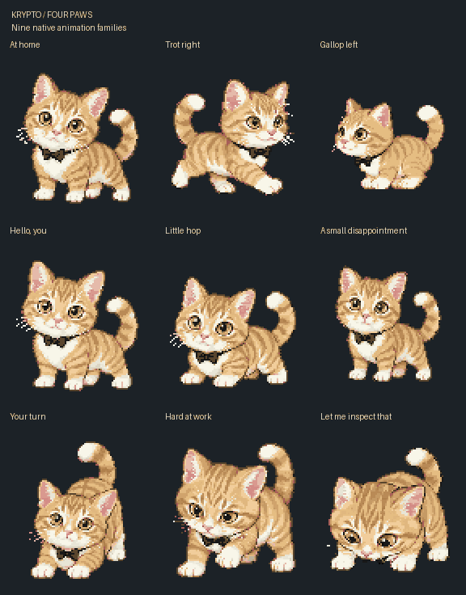

# Krypto in his pixel era 🐾

A golden ginger-and-white cat, four little paws, and one very serious black bow tie.

**[Download for Codex](https://github.com/martinburstein/krypto-pet/releases/latest/download/krypto-codex.zip)** · **[Add to ChatGPT](https://chatgpt.com/s/sharepet_6ae27e3953388191a14be7fb59c0f883)** · **[Watch every animation](https://martinburstein.github.io/krypto-pet/)**

This is **canonical v1**: the original Four Paws artwork. Nine animations, 57 action frames, and 16 directional looks. Free to download and use as your pet. Share this repository with friends.

## Codex on your computer

### The easiest way

Give Codex this request:

> Install the canonical Krypto pet from https://github.com/martinburstein/krypto-pet into my local Codex pets folder. Preserve any existing different installation.

Then open **Settings → Pets → Refresh** and choose **Krypto · Four Paws**. Each person installs a separate local copy, so this works for your computer and Katie's computer.

### Manual download

1. [Download the Codex ZIP](https://github.com/martinburstein/krypto-pet/releases/latest/download/krypto-codex.zip) and unzip it.
2. Put its `krypto-four-paws` folder inside your Codex `pets` folder:
   - Windows: `%USERPROFILE%\.codex\pets\`
   - macOS/Linux: `~/.codex/pets/`
   - If you use a custom `CODEX_HOME`, use its `pets` folder instead.
3. Refresh the pet list and select **Krypto · Four Paws**.

The ZIP contains just `pet.json` and `spritesheet.webp`, inside the correct folder.

If you downloaded this whole repository and have Python 3, you can also run `python install.py` (or `python3 install.py`). It verifies the canonical files and refuses to overwrite a different existing pet. It does not change your active pet automatically.

## ChatGPT — yours or Katie's

Open **[Add Krypto to ChatGPT](https://chatgpt.com/s/sharepet_6ae27e3953388191a14be7fb59c0f883)** while signed into your own ChatGPT account, then use the adoption option shown. Katie can use the same public link with her account to get her own copy.

Select Krypto in ChatGPT's pet settings where Pets are available. A desktop Codex installation does not automatically add a pet to your ChatGPT account.

### On a phone

Open the same adoption link on your phone. Pets availability and display depend on the ChatGPT app, account, and workspace; this repository cannot enable a missing Pets feature. OpenAI documents the floating overlay for the desktop app, not as a phone overlay. The [animation preview](https://martinburstein.github.io/krypto-pet/) works in a phone browser regardless.

If your app does not expose adoption, try the link in a browser with ChatGPT Work. The [official Pets guide](https://learn.chatgpt.com/docs/pets) explains the currently supported surfaces and settings.

### Manual ChatGPT upload

The adoption link is easiest. For upload dialogs that require a **1536 × 1872** image, [download the compatibility PNG](https://github.com/martinburstein/krypto-pet/releases/latest/download/krypto-chatgpt-legacy.png) and use **Upload pet** in ChatGPT's pet settings. It contains all nine animations and 57 action frames.

For systems accepting the **1536 × 2288** format, [download the full ChatGPT sheet](https://github.com/martinburstein/krypto-pet/releases/latest/download/krypto-chatgpt.png); it also includes all sixteen looks.

## What's included

| Folder/file | Contents |
|---|---|
| `codex/krypto-four-paws/` | Original desktop manifest and lossless sprite sheet |
| `chatgpt/` | ChatGPT-compatible full and legacy sheets |
| `downloads/` | Ready-to-download packages |
| `previews/` | Individual animation GIFs |
| `frames/` | All canonical action and look PNGs |
| `editable/` | Matching indexed pixel source frames |
| `docs/` | Public animation gallery |
| `krypto.json` | Version and compatibility metadata |
| `SHA256SUMS` | Checksums for the distributed files |

The artwork is version 1.0.0. `spriteVersionNumber: 2` is the app's eleven-row **file format**, not the rejected face-edit revision. The ChatGPT adapter only clears an unused desktop reference cell; every actual action and look drawing is pixel-identical to canon.

The source photograph, private project history and machine-specific metadata are not part of this public package.
